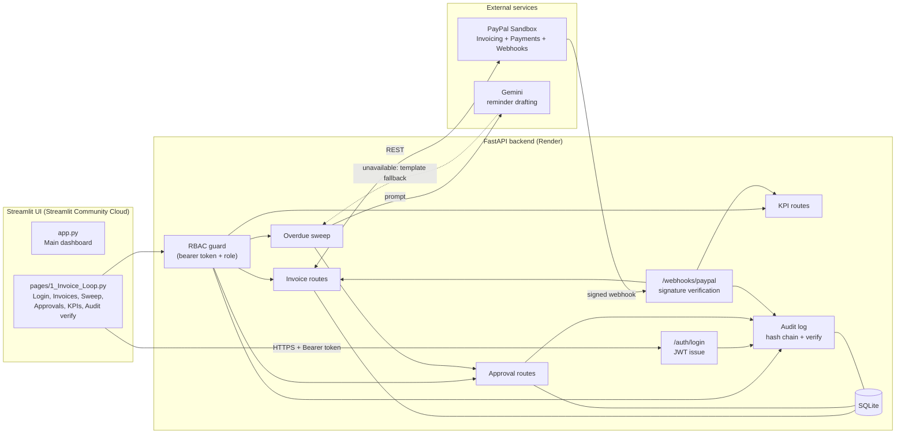
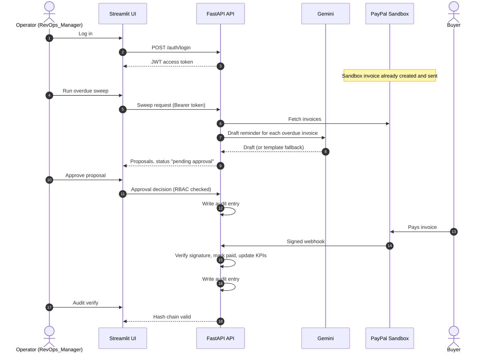

# Revenue Guardian

**An AI agent that chases late invoices, with a human always in control.**

Built for the PayPal AI Hackathon.

[](LICENSE)


| | Link |
|---|---|
| Live demo (UI) | https://revenueguardian-paypal-nttx7ypa4k4dv3qsmbfccy.streamlit.app |
| Live API | https://revenue-guardian-api.onrender.com |
| API docs | https://revenue-guardian-api.onrender.com/docs |
| Demo video | `ADD_YOUTUBE_LINK` |
| Release | tag `submission-v1` on branch `hackathon/dev` |

---

## The problem

Small businesses lose time and cash chasing overdue invoices. Reminders are manual, easy to forget and awkward to write. An AI agent could do the chasing, but letting it message customers or touch money without oversight is risky.

## The solution

Revenue Guardian does the tedious work and keeps a person in charge:

1. It reads invoices created in the **PayPal sandbox**.
2. An **overdue sweep** finds invoices past their due date.
3. **Gemini drafts** a friendly reminder for each one. If the model is unavailable, a **template fallback** takes over automatically.
4. Nothing happens until a human **approves** it. **Role-based access control (RBAC)** decides who may approve.
5. When the buyer pays, PayPal sends a **signed webhook**. We verify the signature, mark the invoice paid and update the KPIs.
6. Every login, approval and payment is written to a **hash-chained audit log** that can be verified at any time.

The AI can only propose. A person decides.

---

## Architecture



### End-to-end flow



### Trust by design

| Control | What it does |
|---|---|
| Human-in-the-loop | The AI drafts. No proposal is acted on until a person approves it. |
| RBAC | Every route except `/health` and `/auth/login` requires a valid token. Approval and sweep need a role with billing approval permission. |
| Webhook verification | PayPal webhooks are accepted only if the signature checks out. |
| Hash-chained audit log | Each entry stores a hash that covers the previous entry's hash. Editing any past event breaks every hash after it. |
| Graceful fallback | If Gemini is down, a deterministic template keeps the flow running. |

The audit chain works like this:

```
hash_i = SHA256( hash_(i-1) || event_i )
```

---

## What is real and what is simulated

| Real | Simulated or mock |
|---|---|
| PayPal sandbox invoices and buyer payment | The "simulate payment" shortcut button |
| Signed webhook verification | Demo CRM data (Acme, Globex, Initech) on the main dashboard |
| Approval gate with RBAC | Gmail and Calendar tools (mock fallback) |
| Hash-chained audit log | Reminder sending: **no email is actually sent** |
| Gemini drafting with template fallback | |

---

## Tech stack

- **Backend:** Python, FastAPI, Pydantic, Uvicorn, SQLite
- **Auth:** JWT bearer tokens, PBKDF2-SHA256 password hashing, role-based permissions
- **Payments:** PayPal sandbox REST APIs (OAuth2, Invoicing, Webhooks) via `httpx`
- **AI:** Gemini through `google-genai` and Google ADK, with a template fallback
- **UI:** Streamlit multi-page app
- **Hosting:** Render (API), Streamlit Community Cloud (UI)

---

## Repository layout

```
.
├── app.py                    # Streamlit main dashboard
├── pages/
│   └── 1_Invoice_Loop.py     # Login, invoices, sweep, approvals, KPIs, audit verify
├── main.py                   # FastAPI app and routes
├── models/
│   └── domain.py             # Pydantic request/response models
├── security/
│   ├── auth.py               # JWT, password hashing, demo users
│   └── rbac.py               # Role and permission map
├── tools/                    # PayPal client, Gmail and Calendar (mock fallback)
├── config/                   # Settings loaded from environment variables
├── tests/                    # pytest suite
├── demo.py                   # CLI script to run the loop end to end
├── requirements.txt
└── LICENSE
```

> Folder names reflect the main modules. Adjust any path that differs in your tree.

---

## Try it

### Option 1: use the live demo

1. Open the Streamlit link above and choose **1 Invoice Loop** in the sidebar.
2. Log in with the demo credentials from the Devpost testing notes (user `admin`).
3. Follow the demo flow below.

The free-tier API can take up to a minute to wake on the first request. Open `/health` first if the page reports a session error.

### Option 2: run locally

```bash
git clone https://github.com/ritikayadav-6318/revenueguardian-paypal.git
cd revenueguardian-paypal
git checkout hackathon/dev

python -m venv .venv
# Windows: .venv\Scripts\activate    macOS/Linux: source .venv/bin/activate
pip install -r requirements.txt
```

Create a `.env` file (never commit it):

```env
# PayPal sandbox
PAYPAL_CLIENT_ID=your_sandbox_client_id
PAYPAL_CLIENT_SECRET=your_sandbox_client_secret
PAYPAL_WEBHOOK_ID=your_sandbox_webhook_id

# Gemini
GEMINI_API_KEY=your_gemini_key
GEMINI_MODEL_NAME=your_valid_model_name

# Auth
JWT_SECRET_KEY=change_me_to_a_long_random_value
DEMO_ADMIN_PASSWORD=choose_a_password
DEMO_CFO_PASSWORD=choose_a_password
DEMO_SALES_PASSWORD=choose_a_password

# Demo behaviour
DEMO_OVERDUE_MINUTES=2
```

Start the API and the UI in two terminals:

```bash
uvicorn main:app --reload          # API on http://localhost:8000
streamlit run app.py               # UI on http://localhost:8501
```

To point the UI at a local API, set `API_URL = "http://localhost:8000"` in `.streamlit/secrets.toml`.

### Configuration reference

| Variable | Purpose |
|---|---|
| `PAYPAL_CLIENT_ID`, `PAYPAL_CLIENT_SECRET` | PayPal sandbox app credentials |
| `PAYPAL_WEBHOOK_ID` | Used to verify incoming webhook signatures |
| `GEMINI_API_KEY` | Enables Gemini drafting. Without it the template fallback is used. |
| `GEMINI_MODEL_NAME` | Gemini model to call. A wrong name returns 404, so list valid models for your key. |
| `JWT_SECRET_KEY` | Signs login tokens. Set a fixed value in production so tokens survive restarts. |
| `DEMO_ADMIN_PASSWORD`, `DEMO_CFO_PASSWORD`, `DEMO_SALES_PASSWORD` | Passwords for the seeded demo users |
| `DEMO_OVERDUE_MINUTES` | Minutes after creation before a sandbox invoice counts as overdue |
| `API_URL` (Streamlit secret) | API base URL used by the UI |

---

## Demo flow

1. **Create** a sandbox invoice (run `demo.py` or create one in the PayPal sandbox).
2. **Wait** about 2 minutes so it counts as overdue.
3. **Sweep** tab: run the sweep. Gemini drafts a reminder (or the template fallback does).
4. **Approvals** tab: load the proposal and approve it.
5. **Pay** the invoice as the sandbox buyer. PayPal sends the signed webhook.
6. **KPIs** tab: refresh to see the paid invoice counted.
7. **Audit verify**: confirm the hash chain is intact.

### Demo users

| User | Role | Notes |
|---|---|---|
| `admin` | RevOps_Manager | Full permissions. Use this for the demo. |
| `cfo` | CFO | See `security/rbac.py` for exact permissions |
| `sales` | Sales | Limited permissions, expect 403 on approval routes |

Passwords come from the `DEMO_*_PASSWORD` environment variables.

---

## Testing

```bash
pytest
```

The suite covers the PayPal client, webhook handling, and route protection (every route except `/health` and `/auth/login` must require a valid token).

---

## Deployment

| Part | Where | Notes |
|---|---|---|
| API | Render (free tier) | Set all environment variables above. Add an uptime monitor on `/health` so the service does not sleep. |
| UI | Streamlit Community Cloud | Branch `hackathon/dev`, main file `app.py`, secret `API_URL`. |

Render's free tier resets data on redeploy, so create fresh invoices after each deploy.

---

## Limitations

- Runs against the **PayPal sandbox** only.
- **No reminder email is actually sent.** Gmail and Calendar tools are mock fallbacks.
- Demo CRM data is fake.
- SQLite storage is for demo use, not production scale.

## Roadmap

- Live reminder sending by email, with the same human approval step
- Production PayPal
- More channels, such as SMS and chat
- Per-customer reminder tone and timing
- Real customer data sources in place of the demo CRM

---

## Security notes

- Secrets live in environment variables and Streamlit secrets, never in the repo.
- Demo passwords are throwaway values for judging only.
- Tokens are bearer JWTs. Rotate `JWT_SECRET_KEY` for any real deployment.

## License

MIT. See [LICENSE](LICENSE).

## Author

Built by Ritika Yadav for the PayPal AI Hackathon.
