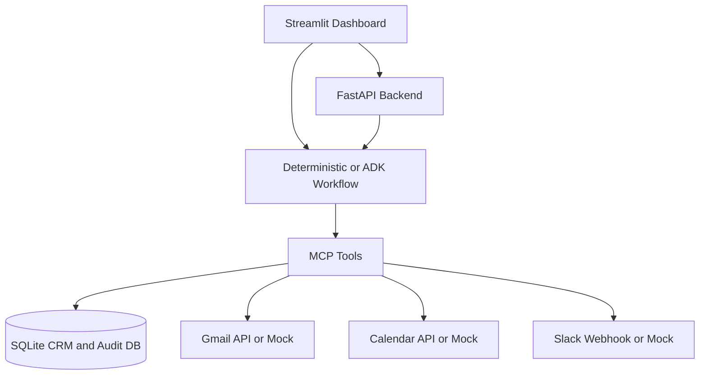

# Revenue Guardian: Autonomous Multi-Agent Revenue Operations Platform

Revenue Guardian is a Revenue Operations demo for auditing pipeline risk, customer communication issues, missed follow-ups, and recovery actions. It supports a deterministic mock mode that works without API keys, plus an optional live ADK/Gemini mode.

## What It Includes

- Streamlit executive dashboard (`app.py`)
- FastAPI backend (`main.py`)
- MCP-style tools for CRM, Gmail, Calendar, Slack, and audit logs
- SQLite CRM and audit database
- JWT authentication and RBAC helpers
- Deterministic local workflow for demos and tests
- Optional Google ADK/Gemini workflow when `USE_LIVE_ADK=true`

## Architecture



See [Architecture Diagrams](docs/architecture_diagrams.md), [Workflow Diagrams](docs/workflow_diagrams.md), and [Deployment Guide](docs/deployment.md).

## Local Setup

```bash
pip install -r requirements.txt
cp .env.example .env
streamlit run app.py
```

The dashboard works in mock mode by default. To try live ADK/Gemini execution, set:

```env
GEMINI_API_KEY=your_key
USE_LIVE_ADK=true
```

## Backend

```bash
uvicorn main:app --reload
```

Useful endpoints:

- `GET /health`
- `POST /auth/login`
- `POST /api/audit/run`
- `GET /api/crm`
- `GET /api/audit/logs`

Demo users are local-only: `admin/admin123`, `cfo/cfo123`, `sales/sales123`.


## Human-in-the-Loop Approvals

Risky actions can be queued before execution:

- `POST /api/approvals` creates a pending approval.
- `GET /api/approvals?status=pending` lists pending approvals.
- `POST /api/approvals/{approval_id}/decision` approves or rejects with a bearer token.

Approval roles are enforced with RBAC. For example, billing actions such as `offer_discount` require `CFO` or `RevOps_Manager`, while email drafts can be approved by sales, customer success, or RevOps roles.

## Docker

```bash
docker compose up --build
```

Dashboard: `http://localhost:8501`
API: `http://localhost:8000/health`

## Tests

```bash
pytest -v
```

## Project Structure

```text
agents/       ADK agents plus deterministic fallback workflow
config/       Settings and .env parsing
docs/         Architecture, workflow, and deployment docs
mcp/          CRM, Gmail, Calendar, Slack, and MCP server tools
models/       Shared Pydantic schemas
scheduler/    Daily workflow scheduler
security/     JWT auth and RBAC
services/     Audit logging service
tests/        Unit tests
app.py        Streamlit dashboard
main.py       FastAPI backend
```

## Production Notes

This project is demo-ready, not fully production hardened. Before production use, replace demo users, enforce RBAC on all mutation endpoints, persist full workflow runs, and implement the full HITL approval queue.
